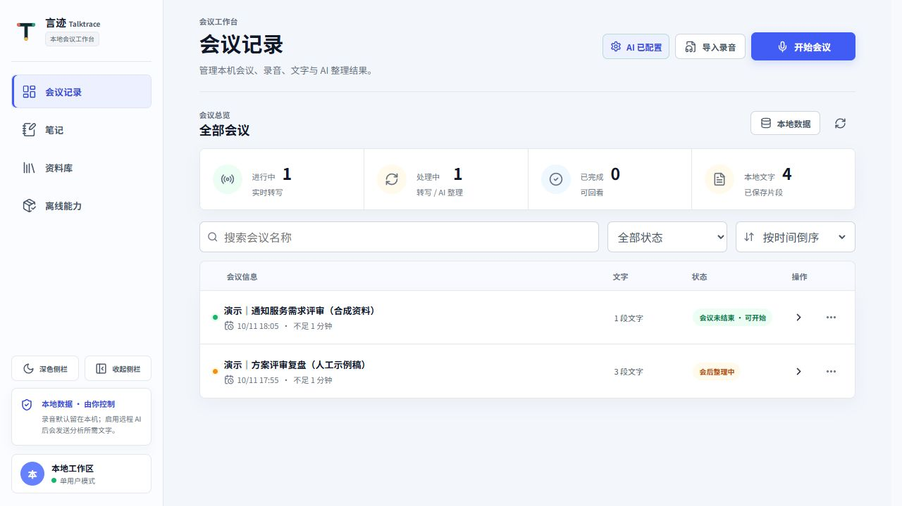
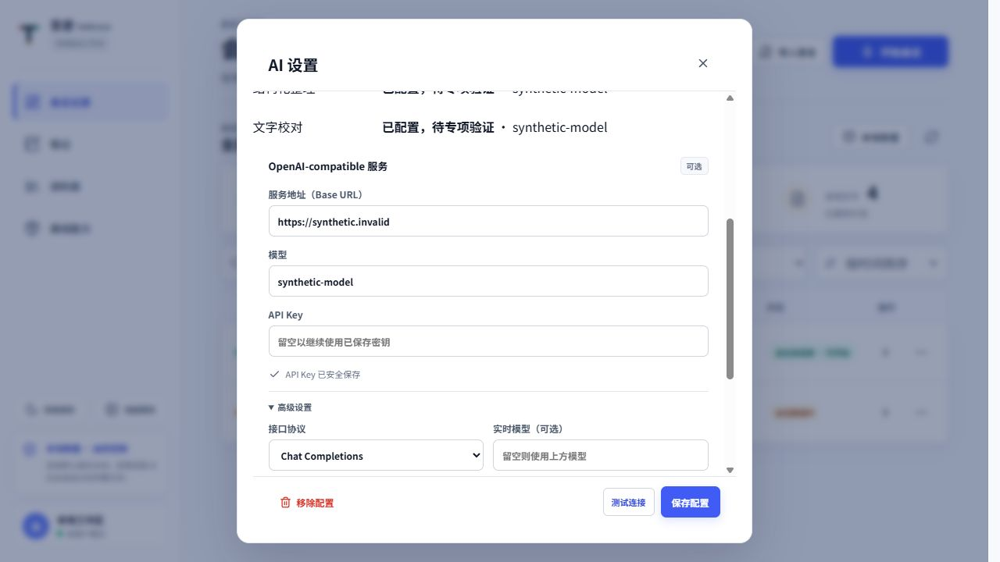
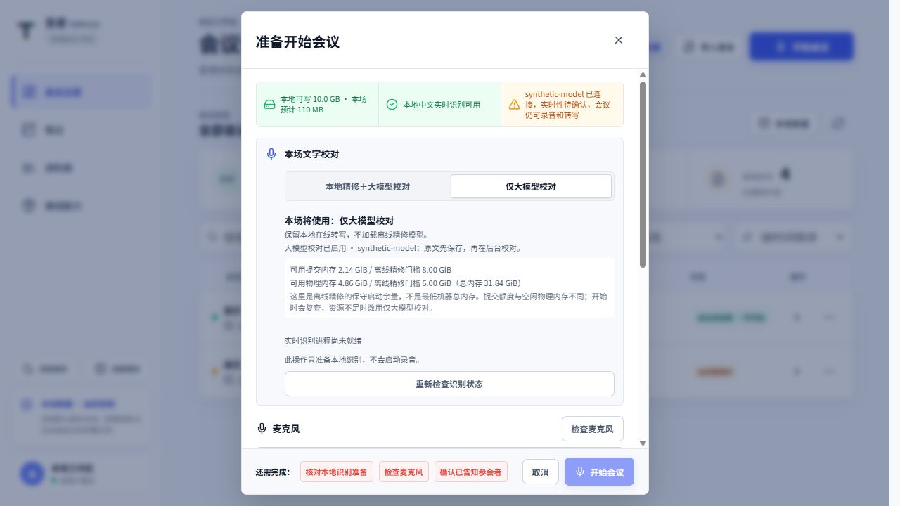
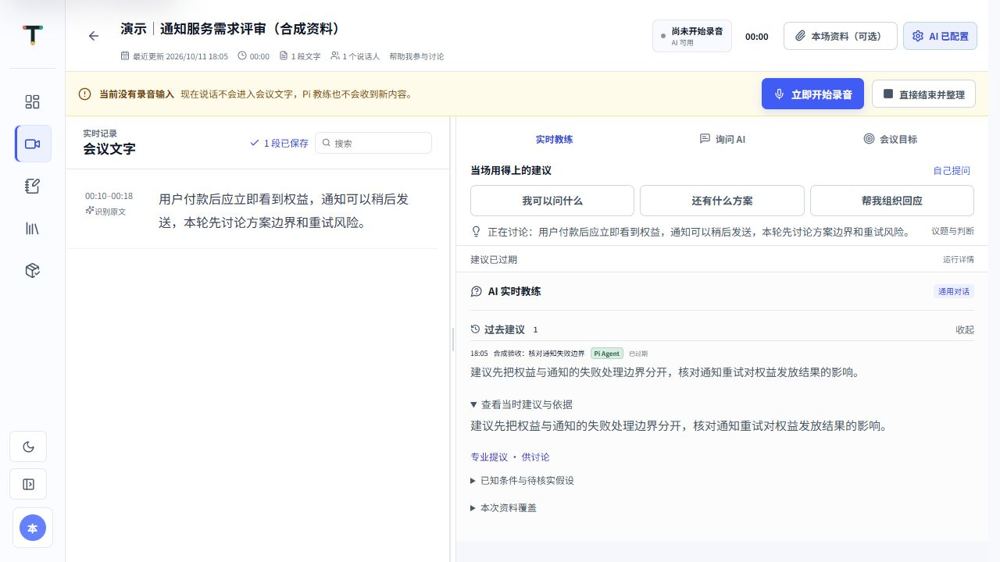
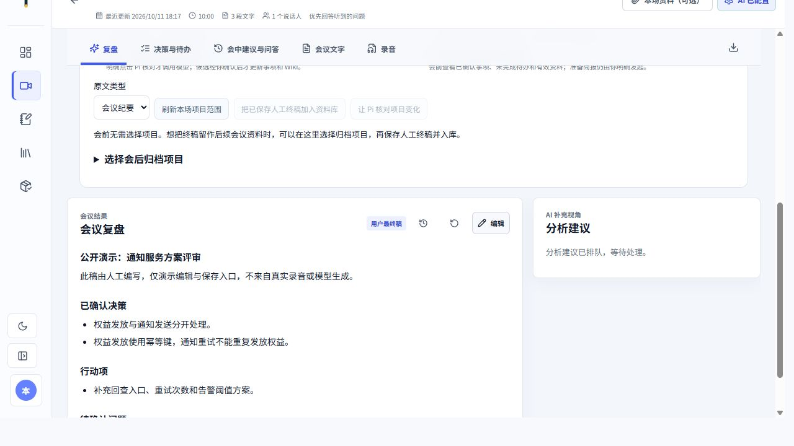
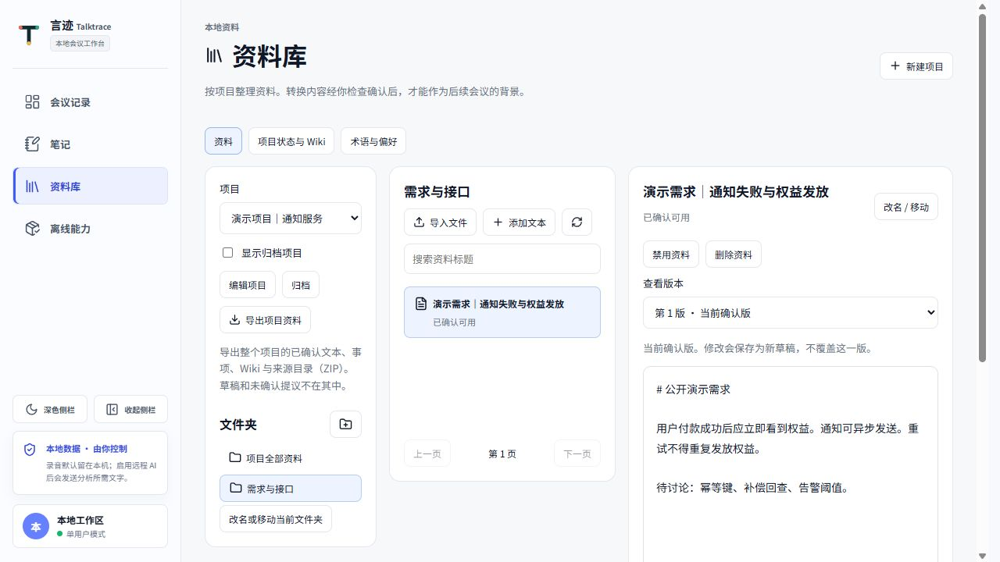

# 言迹 Talktrace 网页版操作手册

适用版本：2026 年 10 月 11 日的本地网页版。安装和启动方法见[网页版部署说明](web-deployment.md)，当前功能与验收边界见[交付状态说明](web-delivery-status-20261011.md)。

言迹帮助你把交流中的声音变成可回看的文字，并在讨论过程中找到可提出的追问、可比较的方案和可说出口的回应。会议结束后，可以核对文稿、整理笔记，再将确认后的资料用于下一次会议。

## 1. 第一次使用：先走通一场会议

1. 启动本机会议服务，用浏览器打开启动信息给出的 `/workbench` 地址。
2. 如需 AI 校对、教练和纪要，打开“AI 设置”，保存你自己的服务配置。
3. 点击“开始会议”，在“准备开始会议”窗口中选择校对模式，检查服务、存储和麦克风。
4. 告知参会者并勾选录音确认，再点击窗口内的“开始会议”。
5. 讨论中阅读左侧已保存文字；需要发言帮助时，使用右侧三个主动入口或“自己提问”。
6. 点击“结束会议”，查看会后整理，核对原文和 AI 初稿，保存人工终稿后导出或入库。

会议主题、角色和资料均为可选项。没有提前准备文档，也可以开始使用。

页面截图使用隔离演示数据，说明操作入口，不代表真实会议内容或模型质量验收结果。

## 2. 设置 AI 服务

点击页头的 AI 状态按钮（可能显示“AI 已配置”），打开“AI 设置”，填写以下内容并点击“保存配置”：

| 字段 | 怎么填写 |
| --- | --- |
| 服务地址（Base URL） | 你的 OpenAI-compatible 服务地址，按服务商提供的地址填写。 |
| 模型 | 该服务实际支持的模型名称。 |
| API Key | 你自己的访问密钥；已有密钥时，留空可继续使用已保存密钥。 |
| 高级设置 → 接口协议 | 按服务能力选择 Chat Completions 或 Responses。 |
| 实时模型（可选） | 用于实时教练；留空继承通用模型。 |
| 转写校正模型（可选） | 用于后台文字校对；留空继承通用模型。 |

保存后可按需点击“测试连接”。测试会向所配置的模型发送最小工具调用，可能产生费用。“模型工具调用通过”只说明这次连接测试成功；页面也会提示“Pi 实时链路待验收”。校对、会中建议和会后纪要的实际效果与延迟仍需要分别检查。

“各功能当前状态”用于查看不同通道的配置、处理和最近请求结果。通用模型可连接，不代表每个功能都已经成功执行。

未配置 AI 时，本地转写仍可使用；AI 校对、教练、问答和纪要需要相应配置。配置和数据保存在运行会议服务的电脑上。共享截图或文档前，检查密钥、服务地址和会议内容。

启用远程 AI 后，会发送分析所需的会议文字及已授权资料片段。原始录音默认保存在本机；上传文件后，先检查正文和允许范围，再启用为会议背景。

## 3. 会前准备与两种校对模式

### 选择本场模式

在“准备开始会议”窗口的“本场文字校对”中选择：

| 模式 | 本场处理方式 |
| --- | --- |
| 本地精修＋大模型校对 | 本地在线识别收到文字后，尝试使用离线模型精修，再由已启用且已配置的大模型在后台校对。 |
| 仅大模型校对 | 保留本地在线转写，跳过离线精修模型，由已启用且已配置的大模型在后台校对。 |

“仅大模型校对”仍需要本地在线语音识别；它省去的是离线精修模型。两个模式都会先保存识别文字，后台校对尚未完成时仍可阅读。

页面分别显示“当前选择”或“本场将使用”的模式，以及大模型校对是否启用、是否缺少配置。选中某种模式不等于对应模型已经就绪。已有录音或会议文字的场次会沿用已保存模式，不能在中途切换。

### 看懂内存和准备状态

页面列出可用提交内存、可用物理内存、系统总内存和离线精修门槛。提交额度与空闲物理内存是不同指标；门槛表示离线精修的保守启动余量，不是最低机器总内存。

- 明确检测到资源不足时，页面说明本场将改用“仅大模型校对”，在线转写继续保留。
- 无法确认资源或本地组件缺失时，页面要求重新检查，或由你明确选择“仅大模型校对”。
- 本地精修未准备完成时，按页面提示点击“准备离线识别”；上次准备失败时可能显示“重新准备”。这一步会加载本地模型，不启动录音。
- “重新检查识别状态”只读取状态和资源，不启动录音或远端模型测试。
- 大模型校对关闭或缺配置时，页面会说明无法进行大模型校对。仅大模型模式此时只保留在线识别原文。

开始收音时，服务还会复查资源，并记录实际使用的模式。其他识别组件或资源保护失败仍可能阻止开始；选择仅大模型不会跳过在线识别要求。

### 检查声音和录音告知

1. 选择本次使用的麦克风。
2. 点击“检查麦克风”。这一步会短暂请求麦克风权限，允许权限后说一句话，确认出现“正常收到声音，麦克风可用”。
3. 检查本地实时识别与存储状态；“开始会议”下方的检查项可帮助定位尚未满足的条件。
4. 告知参会者，勾选“我已告知参会者并确认可以录音”。
5. 点击窗口内的“开始会议”，进入正式采集。

仅打开准备窗口、切换校对模式或查看资源，不会自动使用麦克风。网页版通过浏览器麦克风采音；Windows 系统音频直采和双轨属于桌面采集能力，不能把它们当作网页版已具备的入口。电脑外放由麦克风拾取时，效果也会受距离、回声和背景声音影响。

“本场主要帮助”可选择“帮助我参与讨论”或“优先回答听到的问题”。前者关注追问、方案和回应，后者优先回应听到的问题；两者都可使用会中的主动入口。

## 4. 提前上传资料：核对后再用于本场

打开“本场资料（可选）”或“本场资料”，点击“添加 DOCX、文本 PDF、TXT 或 MD”。文件会在后台转换，不必等待转换完成才开始录音。

1. 等待文件出现可预览正文，检查标题、数字、人名、接口参数和遗漏。
2. 如需修改，先“加载后续正文”直到正文完整加载，再点击“修正正文”，完成后“保存新版本”。
3. 在“本场允许读取的范围”中选择“允许使用整个文件”或“仅使用选中的正文片段”。
4. 点击“用于本场背景”，确认页面显示正在使用的版本与范围。

上传和预览不会自动启用资料。“用于本场背景”允许按相关片段取用，不表示 AI 已通读整个文件。会中修正并保存新版本后，也应核对实际启用的是哪一版。

转换失败可“重试转换”；不需要时可“停用本场资料”或“移除此附件”。移除会清理对应本地文件与正文，应先确认是否需要保留原件。

当前支持简单文本提取。扫描 PDF 或只有图片的页面可能显示未提取文字、需要 OCR；请提供文字版文件或粘贴文本。复杂、合并或嵌套表格需要人工核对，不能按转换成功认定格式和内容都正确。

如果已有长期资料，在会前选择项目和所需文件夹或文档即可。会中调整范围后点击“保存资料范围”，后续回答才使用保存后的范围；已有引用会重新检查有效性。

## 5. 会中：阅读正文，让建议帮助你当场发言

### 左侧文字怎么读

左侧“段已保存”表示正式识别正文已经保存在本机。“正在识别”的临时草稿在独立小区域更新；草稿尚未正式保存，不应当作稳定历史。

| 标签 | 含义 |
| --- | --- |
| 识别原文 | 正式识别文字已保存，尚无有效 AI 校对结果。 |
| 识别原文 · 校对中 | 后台正在校对，原文仍可阅读。 |
| 已校对 | 已保存有效校对结果；仍应核对关键事实。 |
| 校对未改字 | 已完成有效校对，模型没有修改文字。 |
| 已保留原文 / 部分已校对，仍有原文 | 某些校对未完成或未通过核对，保留识别原文。 |
| 补识别原文，未做AI校对 | 从历史录音补识别得到的文字，尚未经过 AI 校对。 |

“已保存”和“已校对”都不代表已由人确认。遇到重要数字、否定词、承诺条件或人名，结合上下文和录音核对。错误文字可能影响后续建议，手动提问时可直接说明正确事实或选择更可靠的原文范围。

### 右侧三个主动入口

右侧顶部的“当场用得上的建议”提供：

| 入口 | 什么时候用 |
| --- | --- |
| 我可以问什么 | 希望找到当前讨论尚未明确的约束、风险或追问。 |
| 还有什么方案 | 希望比较替代方案、取舍和验证方法。 |
| 帮我组织回应 | 已有观点，希望整理成可以直接说出口的话。 |

这些按钮会请求 AI，可能产生费用。请求处理中等待结果，避免连续点击重复发起。自动教练会围绕已收到的讨论生成建议；并非每句话都必须有新卡片。没有当前建议时，可查看状态说明或主动发起请求。

先读建议中的“可以这样说”；有“展开分析与方案”时再查看细节。打开“为什么现在 · 依据原话”或点击“查看依据”，核对建议是否贴合正在讨论的问题。有资料来源时，也要检查引用的文件版本和段落。

“基于截至 HH:mm:ss 的讨论”表示建议使用的讨论冻结时间；生成期间新增的文字可能尚未包含。讨论已经推进时，先核对时点，再请求新的建议。“过去建议”保留历史内容，撤回、过期或已讨论的建议不应当作当前结论。

图中未开启录音，展示合成资料的已保存原文与一条已过期的历史建议；展开“查看当时建议与依据”可核对来源。三个主动入口可见，此图不代表新建议生成或真实会议效果。

### 自己提问、选范围、存笔记

点击“自己提问”进入“询问 AI”。按问题选择“选中文字”“最近内容”“当前章节”“整场会议”或“本场资料（无需会议文字）”。“最近内容”可选择时间范围；可勾选“同时参考本场已启用附件与所选项目的已确认资料”。

例如，在需求评审中提问：“这个接口方案还有哪些兼容性或回滚条件没有明确？给我一句可以当场提出的追问。”问题越聚焦，越容易核对回答是否有价值。

“我刚错过了什么”用于了解最近讨论。重要回答可点击“存为笔记”，以后在“笔记”查看并补充。历史回答若提示依据已变化或已过期，应核对来源并重新提问。

需要临时停止采集时使用“暂停录音”与“继续录音”。讨论结束使用“结束会议”；直接关闭页面不能替代检查录音已经结束和保存完成。另一窗口仍在录音时，当前只读页面不会接管其暂停和结束操作。

## 6. 会后：核对 AI 初稿，保存人工终稿

打开结束的会议，查看“复盘”“决策与待办”“会中建议与问答”“会议文字”和“录音”。

顶部“整理进度”反映文件和任务就绪情况，不代表人工核对完成。AI 纪要已经生成，原文校对仍有失败，是可能出现的组合。看清校对覆盖数量、剩余原文和质量提示，再使用纪要。

1. 在“录音”核对容易误听的内容，并检查录音是否完整、是否可播放。
2. 在“会议文字”检查原文；需要修正时点击“编辑最终文字”。
3. 在“复盘”核对纪要中的结论、未确认问题；在“决策与待办”检查负责人、期限、决策状态和风险。
4. 使用对应的编辑入口修改。页面自动保存；等到“用户最终稿已保存”或“用户最终文字已保存”，再导出或切换。
5. 保存失败时保留当前草稿，按提示“重试”或“重试保存”；不要把“完成编辑”或刚输入的内容当作已经落盘。

图中终稿是通过“编辑”输入并保存的公开人工示例，分析建议仍在等待处理。该图演示人工整理与保存后的呈现，不代表 AI 校对或自动纪要任务已完成。

### 失败后怎么重试

- 纪要、分析建议或内容索引失败：先恢复相应 AI 配置与连接，再使用顶部对应任务的重试按钮。
- 原文校对失败：查看“查看未完成校对的原文”，核对原因后按需点击“重试 AI 校对”。任务已终态且原文保留时，不必一直等待。
- 等待 AI 配置的后台任务：配置恢复后可以继续；已终态失败的任务按页面提示重新发起。
- 反复失败：保留录音和文字，先完成人工终稿。重试可能产生新的模型费用，不能保证把误听内容恢复为正确语义。

历史录音的补识别文字与实时校对队列的衔接尚不完整。若页面标注“补识别原文，未做AI校对”，按录音核对并保存人工最终文字；不要假设反复点击实时校对重试就一定覆盖这种来源。

### 导出会议

点击“导出会议”，选择 Markdown、Word 文档或 JSON。浏览器会下载文件，通常存放在浏览器下载目录。还有未保存修改时，先保存成功再导出。

导出反映已保存版本；导出成功不表示 AI 初稿已经人工确认。

## 7. 笔记、资料库与下一次会议

“笔记”用于保存问答和个人记录；“本场资料”服务于当前会议；“资料库”用于按项目与文件夹整理可复用资料。

### 从笔记继续整理

进入“笔记”，按会议或关键词查找。可修改标题与正文、查看关联原文、归档或恢复笔记。编辑后等待“已保存”。需要长期复用时点击“加入项目资料库”，选择项目与文件夹，导入当前已保存版本为草稿。

笔记保存后不会自动成为后续会议背景。依据过期的笔记应先核对来源。

### 在资料库确认版本

1. 在“资料库”新建或选择项目，按需要新建文件夹。
2. “导入文件”或“添加文本资料”；也可从笔记、已保存人工终稿入库。
3. 检查“转换文本”，修正错字和遗漏；“保存修改为草稿”保留待确认版本。
4. 点击“确认这一版可用”，使这版资料成为已确认背景。
5. 下次开会时选择同一项目，并明确允许使用的文件夹或资料范围。

图中选中“需求与接口”文件夹，展示第 1 版已确认资料及正文，内容为公开合成示例。

已确认版的修改会另存为新草稿，旧版保留。“查看资料版本”可比较历史；旧引用或原来源变化时，按提示重新核对。禁用资料会停止其后续使用。

会前未选项目也可以会后选择“选择会后归档项目”，保存本场项目范围，再把已保存人工终稿加入资料库。导入后仍需到资料库确认。

“项目状态与 Wiki”中的事项、决定和待办需要单独审核确认。把文稿放进资料库，不会自动更新项目状态。可按需使用“让 Pi 核对项目变化”生成候选，再检查并确认；此操作会调用已配置模型。“术语与偏好”同样以明确确认的内容复用，不代表模型自动训练完成。

“导出项目资料”下载 ZIP，包含已确认文稿、项目事项、Wiki 与来源目录；草稿和未确认提议不包含在其中。

## 8. 导入已有录音与管理本地数据

在会议入口选择“导入录音”，选择或拖入 WAV、MP3、M4A、AAC、FLAC、MP4 或 MOV。页面限制单文件不超过 500MB；格式转换还依赖本机已安装的对应能力。

检查标题后点击“开始导入”。任务在后台运行，关闭导入窗口不会主动取消处理；可以“打开会议”查看结果。失败且可重试时使用“重试导入”。导入文件不需要启动麦克风，得到的转写和整理内容仍需核对。

会议列表的“本地数据”用于设置保留时间；单场会议的“管理本地数据”用于选择删除范围。自动删除仅处理已结束且超过所选期限的会议，范围是整场会议。删除无法撤销，操作前先导出需要保留的内容。

## 9. 常见提示与处理方法

| 看到的情况 | 建议处理 |
| --- | --- |
| 无法连接本地服务 / 版本不匹配 | 确认会议服务已启动，打开它给出的工作台地址；重新刷新页面。 |
| 等待麦克风权限 / 权限被拒绝 | 在浏览器地址栏权限和系统麦克风设置中允许访问，再“检查麦克风”。 |
| 麦克风正常但没有声音 | 核对输入设备、系统静音与距离；需要时换已确认的录音文件验证。 |
| 实时识别未就绪 | 查看识别状态和“离线能力”，修复在线组件后重查。AI 配置不能代替语音识别组件。 |
| 本地精修内存不足 / 准备失败 | 看清实际内存和门槛，释放本机资源后重新检查或重新准备；也可选择仅大模型模式。 |
| 只有原文、暂未校对 | 原文可读；先看 AI 校对是否启用、是否缺配置，再检查校对状态和失败原因。 |
| 教练无建议 / 响应慢 | 查看折叠状态、当前讨论与请求结果；用顶部主动入口或自己提问。远端模型延迟和失败仍会影响结果。 |
| 建议与当前话题不符 | 检查冻结时间和依据；展开“议题与判断”，按需要纠正当前议题或标记已讨论，再请求新建议。 |
| 扫描 PDF 没有正文 | 提供文字版 PDF、DOCX、TXT、MD，或将文本粘贴为资料。 |
| 另一窗口录音中 / 会议待恢复 | 先返回正在采集的窗口；恢复声音权限需要明确操作。查看旧会议不会自动重新开启麦克风。 |
| 纪要失败但文字已保存 | 保留原文，恢复模型配置后按需重试纪要；也可先手工整理并保存终稿。 |
| 修改保存失败 | 保留当前草稿，读取或比较最新版本后按提示重试保存，确认“已保存”再离开。 |

## 10. 第一次人工验收建议

用一段你熟悉的讨论检查：历史正文持续追加、刷新后仍在；关键人名、数字和否定词可核对；三种主动入口能给出贴合当前话题的内容；引用能定位到正确原文和资料版本；会后终稿保存、刷新和导出一致。

复杂噪声、多人同时说话、长时间会议和不同模型的效果仍需分别验证。当前提供这些功能与处理入口，不代表真实语音准确率、建议价值、所有设备兼容性和整场性能已经完成验收。
