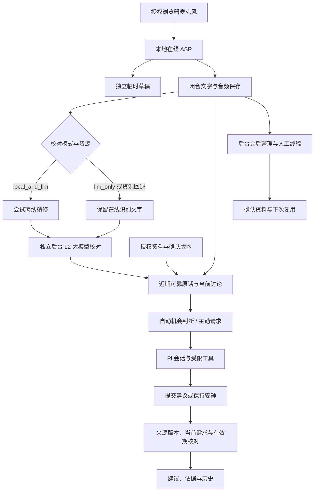

# 网页版当前架构与 Pi 流程

更新：2026-10-11。本文描述当前源码，不把计划中的通用智能体、浏览器系统音频和自动学习当作已交付能力。

## 组件与职责

| 组件 | 当前用途与源码 |
| --- | --- |
| React / TypeScript / Vite | 会前、会议文字与教练、复盘、笔记、资料库；[前端](../code/web_mvp/frontend_v2/src) |
| FastAPI / SQLite | API、事件流、文稿版本、任务、设置与本地持久化；[后端](../code/web_mvp/backend/meeting_copilot_web_mvp) |
| FunASR / Torch CPU worker | 在线转写与离线精修分进程；[语音运行时](../code/asr_runtime/scripts) |
| Pi Agent Core / Pi AI 0.84.2 | Agent 会话、模型适配、受限工具调用、提交结构化贡献；[bridge](../code/agent_runtime/pi_coach_bridge/src) |
| OpenAI-compatible Provider | 建议、文字校对、问答和后台整理；模型与协议可配置 |
| 网页启动工具 | 模型校验、安装检查、受管启停与身份核对；[web_quality.py](../tools/web_quality.py) |

构建的前端由同一后端端口托管。关闭浏览器不等于停止服务。模型权重、数据与凭据在本机，与源码分开。

## 从声音到建议

草稿可被更新，已保存正文持续追加。校对、未改字和失败是不同状态；失败保留原文，不能冒充人工确认。离线失败不应阻断独立 L2；L2 关闭或缺配置时明确保留原文。恢复历史音频得到的文字与 L2 的统一衔接仍有缺口，见[交付状态](web-delivery-status-20261011.md)。

## Pi 的实际作用与边界

Pi 是智能体运行 SDK，价值来自上下文、工具和发布约束。它仍通过配置的模型推理，SDK 本身不会保证建议质量，也不会自动获得联网、无限记忆或行业知识库。

当前 bridge 提供任务与会话边界，向模型提供近期可靠原话、角色与关注点、讨论工作记忆和授权资料。工具向宿主读取有范围与版本的内容，模型可提交结构化建议或保持安静；宿主核对引用、来源身份、当前讨论和有效期后发布。工具次数有上限，不能无限循环。中文提示词见 [participation.mjs](../code/agent_runtime/pi_coach_bridge/src/participation.mjs)，请求构造见 [pi_coach_runtime.py](../code/web_mvp/backend/meeting_copilot_web_mvp/pi_coach_runtime.py)。

提示词要求理解最新讨论后提出一个对方案取舍、业务结果或验收标准有增量的观点，区分原话、专业提议和待核实假设。旧工作记忆不自动代表当前需求，过期建议进入历史。三个主动按钮分别提供追问、方案比较和组织回应意图。

自动建议不是固定每几秒必出一条。新正文、当前机会、去重、已有任务、时间预算、失败熔断和增量价值共同约束执行。策略见 [automatic_coach_policy.py](../code/web_mvp/backend/meeting_copilot_web_mvp/automatic_coach_policy.py)、[realtime_intelligence.py](../code/web_mvp/backend/meeting_copilot_web_mvp/realtime_intelligence.py)、[participation_contract.py](../code/web_mvp/backend/meeting_copilot_web_mvp/participation_contract.py)。显式请求也依赖内容和 Provider，不能承诺固定秒数。

## 上下文、资料与会后延续

- 全文保存在本地；实时任务使用受限近期范围、工作记忆与相关资料，可能遗漏远处信息，不保证每次读完所有附件。
- 资料先转换，修订确认版本，再明确启用本场背景。项目/文件夹控制复用范围，未授权资料不自动加入。
- 会后任务可重试，人工终稿独立保存。入库产生待确认稿，项目事项与 Wiki 另行确认。
- 术语、偏好和事项是持久资料，不是模型权重自动训练；资料积累仍需范围、来源与冲突管理。
- 使用有限检索与文本定位，不要求运维外部向量数据库；不承诺任意资料都完整命中。

## 扩展与维护

前端通过 API/事件协议使用能力，后端分离识别进程、文字版本、Provider、Pi 会话和后台任务。新增音源或分析场景应复用输入、证据与任务接口，保持录音保存与 AI 任务独立。新增场景先约定代表性输入和验收标准，不能只增加角色提示词就宣称完成通用智能体。

当前优先级是正文保存、真实校对状态、当场有用建议、失败恢复和确认资料复用。公网多人托管、多人归属、复杂 OCR、云端 ASR 和浏览器系统音频直采不属于本轮保证。
